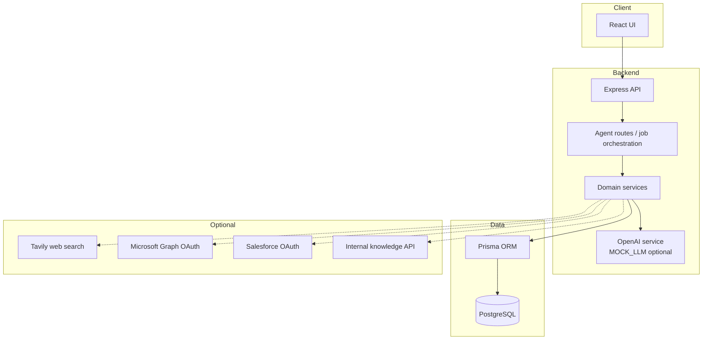

# Sales Intelligence Framework

Portfolio project demonstrating how to build **AI-native sales intelligence** end to end: multi-step agent workflows, CRM/calendar connectors, transcript analysis, RFP research, and workshop prep — with a **local-first** stack (Express + React + PostgreSQL) and **direct LLM calls** instead of heavy RAG infrastructure.

Repository: [github.com/abolmasov/sales-intelligence-framework](https://github.com/abolmasov/sales-intelligence-framework)

---

## Problem & product thesis

Enterprise sellers lose hours before every call: scattered research, stale CRM notes, and generic talk tracks. This project shows a **vertical AI application** that:

- Turns **meeting transcripts** into structured insights, action items, and pursuit artifacts
- Runs **pre-call research** pipelines (web + optional internal knowledge APIs)
- Orchestrates **agent jobs** (transcript analysis, proposals, workshop prep, bulk analysis)
- Keeps humans in the loop with explicit job status and editable outputs

**Thesis:** For many B2B workflows, a well-designed prompt + PostgreSQL + background jobs beats a complex vector/RAG platform — faster to ship, easier to operate, and cheaper at small scale.

---

## Architecture



---

## Agent workflows (high level)

| Agent | Trigger | Output |
|--------|---------|--------|
| Transcript analysis | Meeting with transcript | Structured JSON insights, opportunities, follow-ups |
| Pre-call research | Calendar meeting | Company brief, discovery questions, fit signals |
| Proposal / PPTX jobs | Meeting or workspace | Long-running jobs with status polling |
| Workshop prep | Workspace + client context | Surveys, Miro/PPTX prep artifacts |
| Bulk analysis | Deal or account | Batch jobs across meetings |
| Discovery chat | Natural language query | Grounded answers with optional tool use |

Jobs are persisted in PostgreSQL; the UI polls `/api/agents/runs/:jobId/status`.

---

## Connectors

| Connector | Required? | Purpose |
|-----------|------------|---------|
| OpenAI | Recommended (or `MOCK_LLM=true`) | LLM completions, structured JSON, Whisper |
| PostgreSQL | Yes (local Docker) | All app state |
| Tavily | Optional | Web research enrichment |
| Microsoft Graph | Optional | OAuth login, calendar, mail |
| Salesforce | Optional | Opportunity sync |
| Internal knowledge API | Optional | Case study / KM search (`SALES_INTELLIGENCE_*`) |

All secrets stay in `.env` files (placeholders only in repo).

---

## Quickstart (under 10 minutes)

**Prerequisites:** Node 20+, Docker, npm.

```bash
git clone https://github.com/abolmasov/sales-intelligence-framework.git
cd sales-intelligence-framework

# 1) Database
docker compose up -d postgres

# 2) Backend
cd backend-ts
cp .env.example .env    # MOCK_LLM=true works without OpenAI
npm ci
npx prisma generate
npx prisma migrate deploy
npm run db:seed
npm run dev             # http://localhost:3001

# 3) Frontend (new terminal)
cd ../frontend
cp .env.example .env
npm ci
npm start               # http://localhost:3000
```

**Environment highlights** (`backend-ts/.env`):

| Variable | Notes |
|----------|--------|
| `URL` / `DATABASE_URL` | Postgres URL (matches `docker-compose.yml`) |
| `MOCK_LLM=true` | Deterministic demo LLM responses, no API spend |
| `OPENAI_API_KEY` | Required when `MOCK_LLM` is false |
| `JWT_SECRET` | Session signing for local dev |
| `TAVILY_API_KEY` | Optional research |
| `MS_*` | Optional Microsoft login |

One-command setup from repo root (after Docker is running):

```bash
npm run setup:backend && npm run setup:frontend
```

---

## End-to-end demo (synthetic transcript)

1. Run seed (`npm run db:seed`) — creates fictional accounts **NovaPay**, **Helios**, **Meridian** and a sample transcript.
2. Open the app → **Meetings** / calendar views → select the past **Meridian** meeting.
3. Run **Transcript analysis** agent (or open existing seeded analysis).
4. Review generated action items and pursuit-oriented fields — all from `backend-ts/sample-data/demo-discovery-transcript.txt`.

No real customer names or employer-specific data are included in sample files.

---

## Testing strategy

- **Backend:** Vitest + Supertest with Prisma and external services mocked (`backend-ts/src/test/mocks.ts`, per-route mocks).
- **CI:** Lint, TypeScript `--noEmit`, unit/route tests; frontend production build.
- **Local:** `cd backend-ts && npm test` with `MOCK_LLM=true`.

Tests do **not** call OpenAI or live Microsoft APIs.

---

## Design decisions

1. **Direct LLM calls** with JSON response format for structured steps — simpler than maintaining embeddings pipelines for this domain.
2. **Job table + polling** for long workflows instead of requiring SQS/Lambda for local demos.
3. **Optional connectors** behind env flags so the core UX runs with Postgres + mock LLM only.
4. **Shared TypeScript types** in `shared/` for workspace/analysis shapes used by UI and API.

---

## Cost analysis (typical demo / small team)

| Component | Approx. monthly |
|-----------|-----------------|
| OpenAI (light dev usage) | $30–80 |
| Tavily (optional) | $0–20 |
| Postgres (local Docker) | $0 |
| Hosted DB (optional Neon/Supabase) | $0–25 |
| **Total local portfolio** | **~$0–50** |

Compare to enterprise sales intelligence SaaS at five–six figures ACV — this repo is meant to show **build patterns**, not replicate every enterprise feature.

---

## Roadmap

- [ ] Stronger offline fixture mode for pre-call research (no Tavily)
- [ ] Unified “demo day” script in UI (guided tour)
- [ ] Reduce Recharts shim surface (`frontend/src/utils/rechartsShim.tsx`) when upstream typings catch up
- [ ] Optional SQLite profile for zero-Docker experiments
- [ ] Expanded eval harness for prompt regression tests

---

## License

MIT — Copyright (c) 2026 Roman Abolmasov. See [LICENSE](LICENSE).
